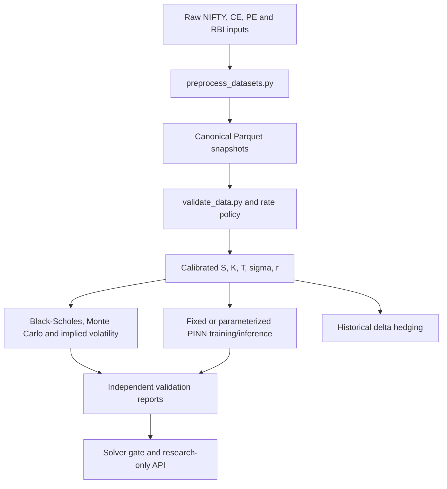

# QuantPINN

NSE-calibrated research code for pricing European NIFTY call (CE) and put (PE) options with physics-informed neural networks (PINNs). The repository combines a calibrated market-data pipeline with Black–Scholes, Monte Carlo, implied-volatility, PINN, validation, and historical delta-hedging components.

> **Status: research-only, not deployed.** The current Kaggle market checkpoint fails the independent analytical solver gate. The API therefore reports `research_only`; this project does not claim production pricing accuracy, live execution, or intraday hedging.

## Contents

- [Research objective](#research-objective)
- [Implemented capabilities](#implemented-capabilities)
- [Mathematical formulation](#mathematical-formulation)
- [Architecture](#architecture)
- [Data and preprocessing](#data-and-preprocessing)
- [Evaluation and current evidence](#evaluation-and-current-evidence)
- [Repository structure](#repository-structure)
- [Installation and local workflows](#installation-and-local-workflows)
- [Testing and validation](#testing-and-validation)
- [Limitations and future work](#limitations-and-future-work)
- [References and license](#references-and-license)

## Research objective

The project investigates whether a PINN can approximate the Black–Scholes pricing PDE across calibrated NIFTY market regimes while remaining auditable against established numerical and analytical references. NIFTY history supplies the underlying and realized-volatility inputs; CE and PE option observations provide market diagnostics; RBI 91-day Treasury-bill data supplies the risk-free-rate input.

Observed option `Close` values are deliberately kept out of the PDE, payoff, and boundary losses in the calibrated training path. They are used for descriptive evaluation only. Agreement with market observations is not evidence that a model has solved the pricing PDE.

## Implemented capabilities

- Canonical preprocessing from raw NIFTY, CE, PE, and RBI inputs to Parquet snapshots.
- Data gates for duplicates, missingness, ranges, contract state, moneyness, underlying consistency, and rate-unit policy.
- European Black–Scholes CE/PE prices and Greeks, including delta, gamma, and vega.
- Antithetic Geometric Brownian Motion Monte Carlo pricing with paired standard errors.
- Black–Scholes implied-volatility inversion and put–call parity diagnostics.
- Fixed-parameter and parameterized PINNs with PDE, terminal-payoff, boundary, and positivity losses.
- Market-parameterized Kaggle training that mixes calibrated parameter rows with synthetic rows and excludes market close from training losses.
- PINN price and Greek inference plus an explicitly labelled no-arbitrage presentation projection.
- Historical daily delta-hedging analysis.
- FastAPI research endpoints with input validation, one-time checkpoint loading, and fail-closed solver readiness checks.
- Checkpoint SHA-256 binding so an acceptance report cannot be reused for another checkpoint.

## Mathematical formulation

The normalized model uses \(x=S/K\), \(y=\tau/T\), and \(u=V/K\), where \(S\) is spot, \(K\) strike, \(\tau\) time remaining, \(T\) maturity, \(r\) the annualized decimal rate, and \(\sigma\) volatility. In the implementation, time is represented in time-to-maturity coordinates and the normalized Black–Scholes residual is:

$$
\frac{u_y}{T} - \frac{1}{2}\sigma^2x^2u_{xx} - rxu_x + ru = 0.
$$

The network is constrained at \(y=0\) by the European payoff:

$$
u(x,0)=\begin{cases}\max(x-1,0)&\text{CE}\\\\\max(1-x,0)&\text{PE}\\end{cases}
$$

Training minimizes the PDE residual together with weighted terminal-payoff and boundary losses; the fixed-parameter trainer also includes a positivity penalty. The parameterized models receive normalized spot, time, volatility, rate, maturity, and an option code. See [`src/pinn/fixed_parameter.py`](src/pinn/fixed_parameter.py) and [`src/pinn/parametric.py`](src/pinn/parametric.py) for the authoritative formulation.

Classical baselines use the same scenario inputs. Monte Carlo simulates terminal GBM payoffs and reports a standard error; Black–Scholes remains the analytical reference for solver validation.

## Architecture



The main layers are:

- `preprocess_datasets.py` and `validate_data.py`: canonicalization and data-quality gates.
- `src/quant/`: analytical, simulation, and implied-volatility references.
- `src/pinn/`: fixed and parameterized PINN definitions, training, inference, and checkpoint loading.
- `src/validation/`: metrics, parity checks, solver reports, and fail-closed acceptance logic.
- `src/api/app.py`: `/health` and `/price` research endpoints.

## Technology stack

| Technology | Role |
| --- | --- |
| Python | Research and execution environment |
| NumPy / pandas / SciPy | Numerical arrays, tabular processing, and statistical functions |
| PyArrow | Parquet data interchange |
| PyTorch | PINN architectures, automatic differentiation, and training |
| FastAPI / Uvicorn / Pydantic | Validated research inference API |
| pytest | Unit and integration-style validation |

Dependencies are declared in [`requirements.txt`](requirements.txt).

## Data and preprocessing

The repository does not distribute raw CSV, Parquet, or model-binary artifacts; `.gitignore` excludes them. The expected prepared inputs are described in [`How to use datasets.md`](How%20to%20use%20datasets.md) and the Kaggle manifest. The calibrated dataset contains daily NIFTY observations, CE and PE option observations with valuation date, expiry, strike, close, spot, contract state, and moneyness, plus monthly RBI rate observations interpreted as annualized percentage yields and converted with a `0.01` scale.

Preprocessing builds realized-volatility fields, maturity and moneyness fields, eligibility flags, and market snapshots. Validation checks option/underlying consistency and date, state, price, and rate policies. The Kaggle manifest records 995,104 CE rows and 1,062,839 PE rows; these are source-manifest counts, not a claim that the data is included here.

## Evaluation and current evidence

The machine-readable reports are under [`reports/`](reports/). `reports/phase1_validation.json` records passed data-quality and pricing-calibration gates. The current independent solver report, [`reports/solver_validation.json`](reports/solver_validation.json), has `status: "failed"`; all five configured analytical checks are false.

| Check | Observed | Threshold |
| --- | ---: | ---: |
| Normalized price MAE | 0.1288801478 | 0.001 |
| Normalized maximum price error | 0.4179729055 | 0.01 |
| Delta MAE | 0.1317828755 | 0.02 |
| Strike-scaled gamma MAE | 0.4904005383 | 0.1 |
| Equivalent-horizon maximum price error | 0.4172341655 | 0.001 |

These values show that the current checkpoint is not an accepted analytical PDE solver. Market-holdout reports are descriptive diagnostics and do not establish production performance. No live deployment or verified production benchmark is provided.

## Repository structure

```text
QuantPINN/
├── configs/                     # Validation and rate policies
├── src/
│   ├── quant/                    # Black–Scholes, Monte Carlo, implied volatility
│   ├── pinn/                     # PINN models, training, inference, checkpoints
│   ├── calibration/              # Rate-policy handling
│   ├── validation/               # Metrics, parity, and solver gates
│   ├── hedging/                  # Historical daily delta hedging
│   └── api/                      # FastAPI research interface
├── tests/                        # Automated tests
├── kaggle/
│   └── nse-pinn-market-training/ # Kaggle GPU training script and metadata
├── reports/                      # Evaluation and validation outputs
├── models/                       # Artifact guidance; binaries are not distributed
├── preprocess_datasets.py        # Build canonical datasets
├── validate_data.py              # Run data-quality gates
├── train_*.py                    # Local PINN training entry points
├── evaluate_*.py                 # Evaluation entry points
├── requirements.txt              # Python dependency ranges
└── README.md                     # Project documentation
```

## Installation and local workflows

The project declares dependencies in `requirements.txt`. A typical local setup is:

```powershell
python -m venv .venv
.\\.venv\\Scripts\\Activate.ps1
python -m pip install -r requirements.txt
```

Prepare the required raw inputs according to [`How to use datasets.md`](How%20to%20use%20datasets.md), then run:

```powershell
python preprocess_datasets.py
python validate_data.py
python -m pytest -q
```

Verified local PINN entry points include:

```powershell
python train_fixed_pinn.py --option-type CE --strike 100 --maturity 0.25 --rate 0.05 --volatility 0.2
python train_parametric_pinn.py
python train_market_parametric_pinn.py
```

The market-parameterized command requires `processed/market_snapshot_ce.parquet` and `processed/market_snapshot_pe.parquet`. The Kaggle workflow requires its private dataset attachment and writes to `/kaggle/working`; see [`kaggle/nse-pinn-market-training/train_kaggle.py`](kaggle/nse-pinn-market-training/train_kaggle.py). Evaluation entry points include `evaluate_solver_validation.py`, `evaluate_pinn_baseline.py`, `evaluate_parametric_pinn.py`, `evaluate_market.py`, `evaluate_parity.py`, `evaluate_hedging.py`, and `evaluate_acceptance.py`.

The API can be started locally with:

```powershell
uvicorn src.api.app:app --reload
```

It exposes `GET /health` and `POST /price`. A compatible research checkpoint is required for PINN pricing; the service fails closed when the checkpoint or solver-gate requirements are unavailable. This is a local interface, not a deployed service.

## Testing and validation

Run the automated suite with:

```powershell
python -m pytest -q
```

The tests cover analytical prices and Greeks, put–call parity, Monte Carlo standard errors, implied-volatility inversion, PINN terminal payoffs and projection bounds, rate conversion, hedging behavior, API validation, and solver-gate fail-closed behavior. Tests requiring the private market checkpoint are skipped when it is absent.

Additional validation commands are:

```powershell
python validate_data.py
python evaluate_solver_validation.py
```

The repository status notes record a verified local run with 27 passing tests and data gates passing. The current solver gate remains failed; passing unit tests do not imply that the PINN is an accepted pricing solver.

## Limitations and future work

- The current Kaggle v2 checkpoint fails the independent analytical PDE protocol and remains research-only.
- Existing acceptance tolerances were selected after observing a market holdout, so market evaluation is not independent model-selection evidence.
- Raw data and model binaries are external/private artifacts and must be obtained separately.
- The API is an inference boundary, not a deployment or production-service claim.
- Hedging is historical daily delta hedging; the project does not claim intraday execution, transaction-cost modeling, or live trading.
- The next milestone is a fresh synthetic-only PINN training run with checkpoint selection against the independent solver protocol, while keeping the market holdout separate for descriptive diagnostics.

## References and license

The configured rate-source reference is the official [RBI](https://rbi.org.in/) current-rates publication. No additional research-paper citation or license file was present in the audited checkout.
